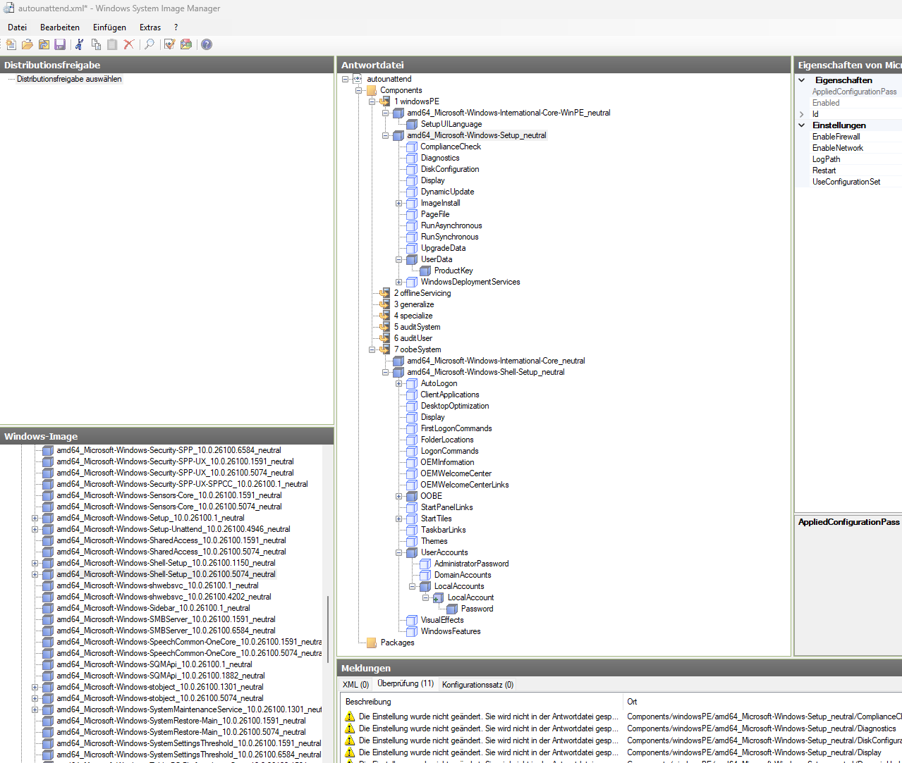

# Windows 11 Installationsimage vorbereiten und bereitstellen

## 1. ISO herunterladen

Lade die aktuelle Windows 11 ISO von:  
https://www.microsoft.com/de-de/software-download/windows11

---

## 2. ISO entpacken oder kopieren

Eine eingehängte ISO ist schreibgeschützt. Die Dateien müssen in einen beschreibbaren Ordner.

### Vorgehen

1. ISO per Rechtsklick bereitstellen
2. Kompletten Inhalt in einen Ordner kopieren, zum Beispiel: `C:\iso_source`

### Beispielstruktur

```
C:\iso_source
├── boot
├── efi
├── sources
├── support
└── setup.exe
```

---

## 3. Verfügbare Editionen im WIM anzeigen

**Wichtig:** PowerShell als Administrator starten (idealerweise PowerShell ISE).

### Editionen auflisten

```powershell
dism /Get-WimInfo /WimFile:C:\iso_source\sources\install.wim
```

### Unbenötigte Editionen löschen

```powershell
dism /Delete-Image /ImageFile:C:\iso_source\sources\install.wim /Index:1
```

**Achtung:** Sobald ein Index gelöscht wird, rückt der nächste nach. Wenn die ersten 4 Editionen gelöscht werden sollen, muss 4x `Index:1` gelöscht werden.

### Erneut prüfen

```powershell
dism /Get-WimInfo /WimFile:C:\iso_source\sources\install.wim
```

Notiere den gewünschten Index, zum Beispiel `1` für Windows 11 Pro, wenn alle anderen gelöscht wurden.

---

## 4. Mount-Ordner anlegen und Image mounten

### Vorherige Mounts prüfen

Vor dem Arbeiten am Image immer prüfen, ob DISM noch ein altes oder kaputtes Mount registriert hat:

```powershell
dism /Get-MountedWimInfo
```

Wenn ein Mount mit Status `Ungültig` angezeigt wird, zuerst bereinigen:

```powershell
dism /Cleanup-Mountpoints
dism /Get-MountedWimInfo
```

Wenn ein Mount mit Status `OK` angezeigt wird, diesen erst sauber aushängen:

```powershell
dism /Unmount-Wim /MountDir:C:\mount /Commit
```

oder ohne Speichern:

```powershell
dism /Unmount-Wim /MountDir:C:\mount /Discard
```

**Wichtig:** Einen Mount-Ordner niemals mit `Remove-Item` löschen, solange ein Image dort bereitgestellt ist. Das erzeugt kaputte DISM-Mounts.

### Ordner erstellen und prüfen

```powershell
New-Item -Path C:\mount -ItemType Directory -Force
Get-ChildItem C:\mount
```

### Falls der Ordner nicht leer ist

```powershell
Get-ChildItem C:\mount -Force
```

Nur wenn `dism /Get-MountedWimInfo` keine bereitgestellten Abbilder mehr anzeigt, darf der Ordner bereinigt werden:

```powershell
Remove-Item -Path C:\mount\* -Recurse -Force -ErrorAction SilentlyContinue
Get-ChildItem C:\mount
```

### Image mounten

Bei `Index` den richtigen Index eintragen (in diesem Fall `1`):

```powershell
dism /Mount-Wim /WimFile:C:\iso_source\sources\install.wim /Index:1 /MountDir:C:\mount
```

Nach diesem Schritt ist das Windows-Dateisystem unter `C:\mount` sichtbar und kann angepasst werden.

---

## 5. Funktionen entfernen oder deaktivieren

### Liste der vorinstallierten Apps anzeigen

```powershell
Get-AppxProvisionedPackage -Path C:\mount |
    Sort-Object DisplayName |
    Select-Object DisplayName, PackageName
```

Alternativ mit DISM:

```powershell
dism /Image:C:\mount /Get-ProvisionedAppxPackages
```

### Empfohlen entfernbare Apps aus der aktuellen Liste

Diese Pakete sind aus der aktuellen DISM-Ausgabe entfernbar, wenn das Image möglichst schlank und cloudarm werden soll:

| Anzeigename | Grund |
| ----------- | ----- |
| `Clipchamp.Clipchamp` | Videoeditor mit Online-/Konto-Fokus |
| `Microsoft.BingNews` | Nachrichten-App |
| `Microsoft.BingSearch` | Bing-/Websuche |
| `Microsoft.BingWeather` | Wetter-App |
| `Microsoft.GamingApp` | Xbox-/Gaming-App |
| `Microsoft.GetHelp` | Online-Hilfe |
| `Microsoft.MicrosoftOfficeHub` | Microsoft-365-/Office-Hub |
| `Microsoft.MicrosoftSolitaireCollection` | Spiel |
| `Microsoft.OutlookForWindows` | Neues Outlook mit Cloud-/Konto-Fokus |
| `Microsoft.PowerAutomateDesktop` | Power Automate Desktop |
| `Microsoft.Todos` | Microsoft To Do |
| `Microsoft.Windows.DevHome` | Dev Home |
| `Microsoft.WindowsFeedbackHub` | Feedback Hub |
| `Microsoft.Xbox.TCUI` | Xbox-Komponente |
| `Microsoft.XboxGamingOverlay` | Xbox Game Bar |
| `Microsoft.XboxIdentityProvider` | Xbox-Anmeldung |
| `Microsoft.XboxSpeechToTextOverlay` | Xbox-Sprachkomponente |
| `Microsoft.YourPhone` | Smartphone-Link |
| `Microsoft.ZuneMusic` | Medien-App/Groove-Nachfolger |
| `MicrosoftCorporationII.QuickAssist` | Remotehilfe |
| `MicrosoftWindows.Client.WebExperience` | Widgets/Copilot-nahe WebExperience |
| `MicrosoftWindows.CrossDevice` | Geräteübergreifende Integration |
| `MSTeams` | Microsoft Teams |

Optional zusätzlich entfernbar, wenn diese Funktionen sicher nicht gebraucht werden:

| Anzeigename | Auswirkung |
| ----------- | ---------- |
| `Microsoft.MicrosoftStickyNotes` | Keine Sticky Notes |
| `Microsoft.Windows.Photos` | Keine moderne Fotos-App |
| `Microsoft.WindowsAlarms` | Keine Uhr-/Alarm-App |
| `Microsoft.WindowsCamera` | Keine Kamera-App |
| `Microsoft.WindowsSoundRecorder` | Kein Sprachrekorder |

Diese Pakete besser behalten, damit Basisfunktionen, Store-/Winget-Infrastruktur, Sicherheit und Medienformate nicht unnötig beschädigt werden:

```text
Microsoft.ApplicationCompatibilityEnhancements
Microsoft.AV1VideoExtension
Microsoft.AVCEncoderVideoExtension
Microsoft.DesktopAppInstaller
Microsoft.HEIFImageExtension
Microsoft.HEVCVideoExtension
Microsoft.MPEG2VideoExtension
Microsoft.Paint
Microsoft.RawImageExtension
Microsoft.ScreenSketch
Microsoft.SecHealthUI
Microsoft.StorePurchaseApp
Microsoft.VP9VideoExtensions
Microsoft.WebMediaExtensions
Microsoft.WebpImageExtension
Microsoft.WindowsCalculator
Microsoft.WindowsNotepad
Microsoft.WindowsStore
Microsoft.WindowsTerminal
```

### Unerwünschte Apps entfernen

Die Entfernung erfolgt über `DisplayName`, damit die Befehle auch dann funktionieren, wenn Microsoft in einer neueren ISO nur die Versionsnummern ändert:

```powershell
$AppsToRemove = @(
    'Clipchamp.Clipchamp',
    'Microsoft.BingNews',
    'Microsoft.BingSearch',
    'Microsoft.BingWeather',
    'Microsoft.GamingApp',
    'Microsoft.GetHelp',
    'Microsoft.MicrosoftOfficeHub',
    'Microsoft.MicrosoftSolitaireCollection',
    'Microsoft.OutlookForWindows',
    'Microsoft.PowerAutomateDesktop',
    'Microsoft.Todos',
    'Microsoft.Windows.DevHome',
    'Microsoft.WindowsFeedbackHub',
    'Microsoft.Xbox.TCUI',
    'Microsoft.XboxGamingOverlay',
    'Microsoft.XboxIdentityProvider',
    'Microsoft.XboxSpeechToTextOverlay',
    'Microsoft.YourPhone',
    'Microsoft.ZuneMusic',
    'MicrosoftCorporationII.QuickAssist',
    'MicrosoftWindows.Client.WebExperience',
    'MicrosoftWindows.CrossDevice',
    'MSTeams'
)

$ProvisionedPackages = Get-AppxProvisionedPackage -Path C:\mount

foreach ($App in $AppsToRemove) {
    $PackagesForApp = $ProvisionedPackages | Where-Object { $_.DisplayName -eq $App }

    if (-not $PackagesForApp) {
        Write-Host "Schon entfernt oder nicht in dieser ISO vorhanden: $App"
        continue
    }

    foreach ($Package in $PackagesForApp) {
        Write-Host "Entferne: $($Package.DisplayName) [$($Package.PackageName)]"
        Remove-AppxProvisionedPackage -Path C:\mount -PackageName $Package.PackageName
    }
}
```

Danach erneut prüfen:

```powershell
Get-AppxProvisionedPackage -Path C:\mount |
    Sort-Object DisplayName |
    Select-Object DisplayName, PackageName
```

---

## 6. KI-Funktionen und Cloud-Integration deaktivieren

### Registry laden

```powershell
# Registry des gemounteten Images laden
reg load HKLM\WIM C:\mount\Windows\System32\config\SOFTWARE
```

### Registry bearbeiten

```powershell
# Copilot per Richtlinie deaktivieren
reg add "HKLM\WIM\Policies\Microsoft\Windows\WindowsCopilot" /v TurnOffWindowsCopilot /t REG_DWORD /d 1 /f

# Bing Websuche deaktivieren
reg add "HKLM\WIM\Policies\Microsoft\Windows\Windows Search" /v ConnectedSearchUseWeb /t REG_DWORD /d 0 /f
reg add "HKLM\WIM\Policies\Microsoft\Windows\Windows Search" /v ConnectedSearchUseWebOverMeteredConnections /t REG_DWORD /d 0 /f
reg add "HKLM\WIM\Policies\Microsoft\Windows\Explorer" /v DisableSearchBoxSuggestions /t REG_DWORD /d 1 /f

# Web-basierte Vorschläge deaktivieren
reg add "HKLM\WIM\Policies\Microsoft\Windows\Windows Search" /v AllowSearchToUseLocation /t REG_DWORD /d 0 /f
reg add "HKLM\WIM\Policies\Microsoft\Windows\Windows Search" /v DisableWebSearch /t REG_DWORD /d 1 /f

# Cortana / Cloud-Suche ausschalten
reg add "HKLM\WIM\Policies\Microsoft\Windows\Windows Search" /v AllowCortana /t REG_DWORD /d 0 /f

# Cloud-Zwischenablage deaktivieren
reg add "HKLM\WIM\Microsoft\Clipboard" /v EnableCloudClipboard /t REG_DWORD /d 0 /f

# Online Tipps und Vorschläge deaktivieren
reg add "HKLM\WIM\Policies\Microsoft\Windows\System" /v AllowOnlineTips /t REG_DWORD /d 0 /f

# Aktivitätsverlauf deaktivieren
reg add "HKLM\WIM\Policies\Microsoft\Windows\System" /v EnableActivityFeed /t REG_DWORD /d 0 /f
reg add "HKLM\WIM\Policies\Microsoft\Windows\System" /v PublishUserActivities /t REG_DWORD /d 0 /f
reg add "HKLM\WIM\Policies\Microsoft\Windows\System" /v UploadUserActivities /t REG_DWORD /d 0 /f

# Telemetrie Level 0
reg add "HKLM\WIM\Policies\Microsoft\Windows\DataCollection" /v AllowTelemetry /t REG_DWORD /d 0 /f

# Hinweis: Bei Windows 11 Pro kann Microsoft AllowTelemetry=0 wie 1 behandeln.
# Für Education, Enterprise und Server ist Level 0 vorgesehen.

# OOBE erzwingt NICHT mehr ein Online-Konto
reg add "HKLM\WIM\Microsoft\Windows\CurrentVersion\OOBE" /v "BypassNRO" /t REG_DWORD /d 1 /f

# Consumer Features deaktivieren
reg add "HKLM\WIM\Policies\Microsoft\Windows\CloudContent" /v DisableConsumerFeatures /t REG_DWORD /d 1 /f
reg add "HKLM\WIM\Policies\Microsoft\Windows\CloudContent" /v DisableSoftLanding /t REG_DWORD /d 1 /f

# Lokale Konten explizit erlauben
reg add "HKLM\WIM\Microsoft\Windows\CurrentVersion\Policies\System" /v "NoConnectedUser" /t REG_DWORD /d 1 /f

# AutoDownload von Windows Apps deaktivieren
reg add "HKLM\WIM\Policies\Microsoft\WindowsStore" /v AutoDownload /t REG_DWORD /d 4 /f
```

### Registry entladen

```powershell
# Registry entladen
reg unload HKLM\WIM
```

---

## 7. Telemetrie-Dienste deaktivieren

`SetupComplete.cmd` wird beim ersten Start nach der Windows-Installation ausgeführt. Die Datei gehört ins gemountete Image:

```powershell
New-Item -Path C:\mount\Windows\Setup\Scripts -ItemType Directory -Force

@'
@echo off

echo [1/10] Telemetrie-Dienste deaktivieren...
sc.exe config DiagTrack start= disabled
sc.exe stop DiagTrack >nul 2>&1

sc.exe config dmwappushservice start= disabled
sc.exe stop dmwappushservice >nul 2>&1

echo [2/10] Werbe-ID deaktivieren...
reg.exe add "HKLM\Software\Policies\Microsoft\Windows\AdvertisingInfo" /v Disabled /t REG_DWORD /d 1 /f

echo [3/10] Feedback und Zufriedenheitsbefragungen deaktivieren...
reg.exe add "HKLM\Software\Policies\Microsoft\Windows\DataCollection" /v DoNotShowFeedbackNotifications /t REG_DWORD /d 1 /f

echo [4/10] Diagnose-Datenerfassung auf minimal setzen...
reg.exe add "HKLM\Software\Policies\Microsoft\Windows\DataCollection" /v AllowTelemetry /t REG_DWORD /d 0 /f

echo [5/10] Bing-Suche im Startmenü deaktivieren...
reg.exe add "HKLM\Software\Policies\Microsoft\Windows\Explorer" /v DisableSearchBoxSuggestions /t REG_DWORD /d 1 /f

echo [6/10] OneDrive-Autostart unterbinden...
reg.exe add "HKLM\Software\Policies\Microsoft\Windows\OneDrive" /v DisableFileSyncNGSC /t REG_DWORD /d 1 /f

echo [7/10] Cloud Content / Empfehlungen / Vorschläge deaktivieren...
reg.exe add "HKLM\Software\Policies\Microsoft\Windows\CloudContent" /v DisableConsumerFeatures /t REG_DWORD /d 1 /f
reg.exe add "HKLM\Software\Policies\Microsoft\Windows\CloudContent" /v DisableSoftLanding /t REG_DWORD /d 1 /f

echo [8/10] Edge Hintergrunddienste reduzieren...
reg.exe add "HKLM\Software\Policies\Microsoft\Edge" /v BackgroundModeEnabled /t REG_DWORD /d 0 /f
reg.exe add "HKLM\Software\Policies\Microsoft\Edge" /v ExperimentationAndConfigurationServiceControl /t REG_DWORD /d 0 /f

echo [9/10] Experience-Features abschalten (Startmenü Werbung, Tipps)...
reg.exe add "HKLM\Software\Policies\Microsoft\Windows\EdgeUI" /v DisableHelpSticker /t REG_DWORD /d 1 /f

echo [10/10] Explorer "Online-Vorschläge" deaktivieren...
reg.exe add "HKLM\Software\Policies\Microsoft\Windows\Explorer" /v DisableSearchHistory /t REG_DWORD /d 1 /f

echo Fertig.
exit /b 0
'@ | Out-File -FilePath C:\mount\Windows\Setup\Scripts\SetupComplete.cmd -Encoding OEM
```

---

## 8. Offline-OOBE und lokales Konto

Der robuste Weg ist der lokale Benutzer in `autounattend.xml` aus Abschnitt 11.7. Die ältere `BypassNRO`-Variante ist nicht als alleinige Lösung einplanbar und wird in Abschnitt 6 nur als zusätzlicher Fallback per Registry gesetzt.

---

## 9. Image unmounten

### Mit Änderungen speichern

```powershell
dism /Unmount-Wim /MountDir:C:\mount /Commit
```

### Ohne Speichern verwerfen

```powershell
dism /Unmount-Wim /MountDir:C:\mount /Discard
```

---

## 10. Windows ADK installieren (nur für ISO-Erstellung)

Für die reine Image-Anpassung ist das ADK nicht nötig. Für eine neue bootfähige ISO wird aber `oscdimg.exe` aus den ADK-Bereitstellungstools benötigt.

Windows SIM muss dafür nicht verwendet werden. Windows SIM ist nur zum grafischen Erstellen oder Prüfen einer `autounattend.xml` gedacht.

### Erforderliches Modul

Du brauchst nur das Modul **"Bereitstellungstools"** (englisch: "Deployment Tools").

**Download:**  
https://learn.microsoft.com/windows-hardware/get-started/adk-install

### Installation per PowerShell

PowerShell als Administrator öffnen:

```powershell
$AdkSetup = "$env:TEMP\adksetup.exe"

Invoke-WebRequest `
    -Uri "https://go.microsoft.com/fwlink/?linkid=2289980" `
    -OutFile $AdkSetup

Start-Process `
    -FilePath $AdkSetup `
    -ArgumentList '/quiet /features OptionId.DeploymentTools /ceip off /norestart' `
    -Wait
```

### Installationspfad

Nach der Installation sollten diese Dateien vorhanden sein:

```powershell
Test-Path "C:\Program Files (x86)\Windows Kits\10\Assessment and Deployment Kit\Deployment Tools\amd64\Oscdimg\oscdimg.exe"
Test-Path "C:\Program Files (x86)\Windows Kits\10\Assessment and Deployment Kit\Deployment Tools\WSIM\imgmgr.exe"
```

Für Abschnitt 12 ist nur `oscdimg.exe` nötig.

---

## 11. Autounattend.xml verwenden oder weglassen (optional)

Die `autounattend.xml` ist unabhängig vom WIM-Umbau. Sie wird nicht gebraucht, um Apps aus `install.wim` zu entfernen oder die ISO zu bauen.

Sie wird nur gebraucht, wenn Windows Setup beim Booten von der ISO automatisch Antworten bekommen soll, zum Beispiel für Sprache, generischen Installationsschlüssel, EULA/OOBE-Dialoge oder einen lokalen Benutzer.

Wenn die Antwortdatei verwendet werden soll, kann sie direkt im Stammverzeichnis der Installationsquelle erzeugt werden:

```powershell
@'
<?xml version="1.0" encoding="utf-8"?>
<unattend xmlns="urn:schemas-microsoft-com:unattend">
    <!-- Setup-Phase (Fenster "Windows installieren") -->
    <settings pass="windowsPE">
        <component name="Microsoft-Windows-International-Core-WinPE" processorArchitecture="amd64" publicKeyToken="31bf3856ad364e35" language="neutral" versionScope="nonSxS">
            <SetupUILanguage>
                <UILanguage>de-DE</UILanguage>
            </SetupUILanguage>
            <InputLocale>0407:00000407</InputLocale>
            <SystemLocale>de-DE</SystemLocale>
            <UILanguage>de-DE</UILanguage>
            <UserLocale>de-DE</UserLocale>
        </component>
        <component name="Microsoft-Windows-Setup" processorArchitecture="amd64" publicKeyToken="31bf3856ad364e35" language="neutral" versionScope="nonSxS" xmlns:wcm="http://schemas.microsoft.com/WMIConfig/2002/State" xmlns:xsi="http://www.w3.org/2001/XMLSchema-instance">
            <UserData>
                <ProductKey>
                    <Key>VK7JG-NPHTM-C97JM-9MPGT-3V66T</Key>
                    <WillShowUI>Never</WillShowUI>
                </ProductKey>
                <AcceptEula>true</AcceptEula>
            </UserData>
        </component>
    </settings>
    <!-- OOBE-Phase (Land, Konto, Datenschutz usw.) -->
    <settings pass="oobeSystem">
        <component name="Microsoft-Windows-International-Core" processorArchitecture="amd64" publicKeyToken="31bf3856ad364e35" language="neutral" versionScope="nonSxS" xmlns:wcm="http://schemas.microsoft.com/WMIConfig/2002/State" xmlns:xsi="http://www.w3.org/2001/XMLSchema-instance">
            <SystemLocale>de-DE</SystemLocale>
            <UILanguage>de-DE</UILanguage>
            <UserLocale>de-DE</UserLocale>
            <InputLocale>0407:00000407</InputLocale>
        </component>
        <component name="Microsoft-Windows-Shell-Setup" processorArchitecture="amd64" publicKeyToken="31bf3856ad364e35" language="neutral" versionScope="nonSxS" xmlns:wcm="http://schemas.microsoft.com/WMIConfig/2002/State" xmlns:xsi="http://www.w3.org/2001/XMLSchema-instance">
            <OOBE>
                <HideEULAPage>true</HideEULAPage>
                <HideOEMRegistrationScreen>true</HideOEMRegistrationScreen>
                <HideOnlineAccountScreens>true</HideOnlineAccountScreens>
                <HideWirelessSetupInOOBE>true</HideWirelessSetupInOOBE>
                <ProtectYourPC>3</ProtectYourPC>
            </OOBE>
        </component>
    </settings>
    <cpi:offlineImage cpi:source="wim:c:/iso_source/sources/install.wim#Windows 11 Pro" xmlns:cpi="urn:schemas-microsoft-com:cpi" />
</unattend>
'@ | Set-Content -Path C:\iso_source\autounattend.xml -Encoding UTF8

[xml](Get-Content -Path C:\iso_source\autounattend.xml -Raw) | Out-Null
```

Wenn du keine automatische Installation willst, diesen Schritt weglassen. Dann fragt Windows Setup Sprache, Key/OOBE und Konto wie bei einer normalen ISO ab.

Windows SIM nur verwenden, wenn die Antwortdatei grafisch geprüft oder neu erzeugt werden soll.

### 11.1 Windows SIM starten

Nach der Installation des ADK befindet sich das Tool hier:

**Startmenü** → **Windows Kits** → **Windows System Image Manager**



### 11.2 Windows Image laden

1. Im linken Bereich unter **Windows Image** auf „Windows Image oder Katalogdatei auswählen" klicken
2. Die Datei auswählen: `C:\iso_source\sources\install.wim`
3. Wenn das Tool fragt, ob eine Katalogdatei erstellt werden soll, mit **„Ja"** bestätigen

Die Erstellung kann einige Minuten dauern.

### 11.3 Neue Antwortdatei anlegen

**Menü** → **Datei** → **Neue Antwortdatei**

Im rechten Bereich erscheinen die Konfigurationsdurchläufe:

1. windowsPE
2. offlineServicing
3. generalize
4. specialize
5. auditSystem
6. auditUser
7. oobeSystem

### 11.4 Sprach- und Regionseinstellungen hinzufügen
Für den Start der Installation ist **windowsPE** der relevante Abschnitt

1. Komponente im Windows Image-Bereich suchen:  
   `amd64_Microsoft-Windows-International-Core-WinPE_neutral`

2. Anklicken und zu **Components → 1 windowsPE** ziehen

Für die automatische Installation ist **oobeSystem** der relevante Abschnitt.

3. Komponente im Windows Image-Bereich suchen:  
   `amd64_Microsoft-Windows-International-Core_neutral`

4. Anklicken und zu **Components → 7 oobeSystem** ziehen

bei Beiden

5. Eigenschaften setzen:
   - `InputLocale = 0407:00000407`
   - `SystemLocale = de-DE`
   - `UILanguage = de-DE`
   - `UserLocale = de-DE`

### 11.5 Windows Produkt-Key hinzufügen
Damit die Installation keine Abfrage nach einem Product-Key anzeigt, wird ein generischer Installationsschlüssel eingetragen. Dieser Schlüssel dient ausschließlich zur Installation und aktiviert Windows nicht.

1. Komponente im Windows Image-Bereich suchen:
   `amd64_Microsoft-Windows-Setup_neutral`

2. Anklicken und zu **Components → 1 windowsPE** ziehen

3. Produkt-Key eintragen

Unter Microsoft-Windows-Setup → UserData:
   - `AcceptEula=true`
überspringt die EULA-Anzeige

Unter Microsoft-Windows-Setup → UserData → ProductKey:
   - `Key=VK7JG-NPHTM-C97JM-9MPGT-3V66T`
   - `WillShowUI=Never`
(Generischer Windows 11 Pro Installationsschlüssel)
verhindert die Key-Abfrage

WillShowUI: Never

### 11.6 Shell Setup für OOBE hinzufügen

1. Komponente suchen:  
   `amd64_Microsoft-Windows-Shell-Setup_10.0.x_neutral`

   Bei mehreren Varianten die Version mit der höchsten Buildnummer verwenden.

2. Anklicken und auch zu **Components → 7 oobeSystem** ziehen

3. In der Antwortdatei den Knoten der Shell Setup-Komponente aufklappen (Plus drücken)

4. Unterpunkt **„OOBE"** auswählen und die Werte setzen:
 
| Einstellung                   | Wert    | Erklärung                                                                |
| ----------------------------- | ------- | ------------------------------------------------------------------------ |
| **HideEULAPage**              | `true`  | Blendet die EULA Seite aus                                               |
| **HideLocalAccountScreen**    |         | Für Windows 11 Pro nicht relevant; diese Einstellung gilt nur für Windows Server |
| **HideOEMRegistrationScreen** | `true`  | OEM Registrierungsseite wird nicht angezeigt                             |
| **HideOnlineAccountScreens**  | `true`  | Verhindert Microsoft Konto Dialoge                                       |
| **HideWirelessSetupInOOBE**   | `true`  | Unterdrückt WLAN Setup Seiten                                            |
| **NetworkLocation**           |         | Setzt Netzwerkstandort automatisch (Home oder Work, abhängig vom Wert)   |
| **OEMAppId**                  |         | Wird von PC Herstellern genutzt, für normale Installationen leer lassen. |
| **ProtectYourPC**             | `3`     | Minimale Telemetrie ohne Benutzerdialog                                  |
| **SkipMachineOOBE**           |         | Überspringt gesamte Maschinen OOBE                                       |
| **SkipUserOOBE**              |         | Überspringt die komplette Benutzer OOBE                                  |
| **UnattendEnableRetailDemo**  |         | Deaktiviert Retail Demo Mode                                             |

Diese Konfiguration reduziert Interaktionen und blendet Microsoft-Konto-Dialoge aus, soweit Windows Setup das für die verwendete ISO zulässt. Für eine wirklich unbeaufsichtigte Installation muss zusätzlich ein lokaler Benutzer in der Antwortdatei angelegt werden.

### 11.7 Lokalen Administrator automatisch anlegen

Wenn kein Benutzer in `autounattend.xml` angelegt wird, fragt Windows während OOBE weiterhin nach einem Konto. Für eine automatische lokale Anmeldung muss unter `Microsoft-Windows-Shell-Setup` ein lokales Konto ergänzt werden.

In der Antwortdatei den Knoten der Shell Setup-Komponente erweitern.
Pfad:
Components → 7 oobeSystem → Microsoft-Windows-Shell-Setup → UserAccounts → LocalAccounts

Rechtsklick und "Neuen LocalAccount einfügen" auswählen.

Für den lokalen Administrator folgende Werte setzen:
| Einstellung     | Wert            | Erklärung                                              |
| --------------- | --------------- | ------------------------------------------------------ |
| **Action**      | AddListItem     | Legt einen neuen Benutzer an                           |
| **Description** | optional        | Beschreibung des Kontos, meist leer                    |
| **DisplayName** | Niko            | Anzeigename des Nutzers                                |
| **Group**       | Administratoren | Ordnet den Benutzer der lokalen Administratorgruppe zu |
| **Name**        | Niko            | Benutzername des Kontos                                |

Dann bei `LocalAccount` auf das Plus-Symbol klicken und bei `Password` die Werte setzen:

| Einstellung   | Wert         |
| ------------- | ------------ |
| **Value**     | das Passwort |
| **PlainText** | `true`       |

**Wichtig:** Ein Klartextpasswort in `autounattend.xml` ist praktisch, aber nicht vertraulich. Das ISO danach wie ein Administrationsmedium behandeln.

### 11.8 Antwortdatei speichern

**Menü** → **Datei** → **Antwortdatei speichern unter**

**Dateiname:** `C:\iso_source\autounattend.xml`

**Wichtig:** Der Name muss unverändert bleiben, da Windows Setup die Datei automatisch einliest.

Damit ist die Antwortdatei vollständig vorbereitet. Beim Start der Installation liest Windows die XML automatisch ein und führt alle Einstellungen selbstständig aus.

---

## 12. ISO erzeugen (optional)

Diesen Schritt nur ausführen, wenn aus `C:\iso_source` wieder eine bootfähige ISO-Datei erstellt werden soll. Dafür wird `oscdimg.exe` aus dem Windows ADK benötigt.

```powershell
Set-Location "C:\Program Files (x86)\Windows Kits\10\Assessment and Deployment Kit\Deployment Tools\amd64\Oscdimg\"

.\oscdimg.exe -m -o -u2 -udfver102 -bootdata:2#p0,e,bC:\iso_source\boot\etfsboot.com#pEF,e,bC:\iso_source\efi\microsoft\boot\efisys.bin C:\iso_source C:\Win11_Custom.iso
```

---

## 13. ISO auf USB-Stick schreiben

Für die angepasste ISO am einfachsten Rufus verwenden. Das Microsoft Media Creation Tool ist dafür nicht geeignet, weil es wieder ein frisches Microsoft-Installationsmedium erstellt und nicht die angepasste `C:\Win11_Custom.iso` verwendet.

### Rufus installieren

```powershell
winget install --id Rufus.Rufus -e
```

**Wichtig:** Nach der Installation PowerShell einmal schließen und neu öffnen. Erst dann ist der neue Befehl `rufus` über den aktualisierten PATH verfügbar.

### Rufus starten

```powershell
rufus
```

### Einstellungen in Rufus

- **Gerät:** USB-Stick auswählen
- **Startart:** `C:\Win11_Custom.iso` auswählen
- **Image-Eigenschaft:** Standard Windows installation
- **Partitionsschema:** GPT
- **Zielsystem:** UEFI
- **Dateisystem:** NTFS

Danach **Start** auswählen. Der USB-Stick wird dabei formatiert.

### Windows-Benutzererfahrung in Rufus

Für eine möglichst saubere Installation mit guter Kompatibilität auf älteren Rechnern:

```text
[x] Anforderung für 4GB+ RAM, Secure Boot und TPM 2.0 entfernen
[x] Anforderung für Online-Microsoft-Konto entfernen
[ ] Ein lokales Benutzerkonto erstellen
[x] Regionale Optionen auf die gleichen Werte wie die dieses Benutzers setzen
[x] Datenerfassung deaktivieren
[x] Deaktivieren der automatischen BitLocker-Laufwerksverschlüsselung
[x] Komfort-Einstellungen
[ ] Den "Windows CA 2023" signierten Bootloader verwenden
[ ] SkuSiPolicy.p7b auf Installation anwenden
```

### Erklärung der Rufus-Optionen

| Option | Empfehlung | Erklärung |
| ------ | ---------- | --------- |
| Anforderung für 4GB+ RAM, Secure Boot und TPM 2.0 entfernen | Aktivieren | Erlaubt die Installation auch auf älteren oder nicht vollständig Windows-11-kompatiblen Rechnern. |
| Anforderung für Online-Microsoft-Konto entfernen | Aktivieren | Ermöglicht die Einrichtung ohne Microsoft-Konto. |
| Ein lokales Benutzerkonto erstellen | Nicht aktivieren | Benutzer wird später bewusst im Setup angelegt, besonders sinnvoll bei mehreren Rechnern. |
| Regionale Optionen auf die gleichen Werte wie die dieses Benutzers setzen | Aktivieren | Übernimmt Sprache, Tastatur und Region vom aktuellen Rechner. |
| Datenerfassung deaktivieren | Aktivieren | Überspringt bzw. minimiert Datenschutzabfragen während der Einrichtung. |
| Deaktivieren der automatischen BitLocker-Laufwerksverschlüsselung | Aktivieren | Verhindert, dass Windows automatisch verschlüsselt und später ein Recovery-Key fehlt. |
| Komfort-Einstellungen | Aktivieren | Reduziert zusätzliche Microsoft-Komponenten wie Teams, Outlook, Copilot und ähnliche Voreinstellungen. |
| Den "Windows CA 2023" signierten Bootloader verwenden | Nicht aktivieren | Nur für spezielle Secure-Boot-Szenarien mit kompatibler Firmware nötig. Für allgemeine Kompatibilität besser auslassen. |
| SkuSiPolicy.p7b auf Installation anwenden | Nicht aktivieren | Sicherheitsmitigation mit UEFI-Lock-Risiko. Nur gezielt nach Test und mit aktualisierten Medien verwenden. |

---

## 14. Zusätzliche Quellen

- https://www.windowspro.de/wolfgang-sommergut/windows-11-antwortdatei-installieren-dialoge-fuer-privatsphaere-benutzerkonto
- https://learn.microsoft.com/de-de/windows-hardware/manufacture/desktop/deploy-a-custom-image?view=windows-11
- https://learn.microsoft.com/en-us/windows-hardware/manufacture/desktop/dism-image-management-command-line-options-s14?view=windows-11
- https://learn.microsoft.com/en-us/powershell/module/dism/get-appxprovisionedpackage?view=windowsserver2025-ps
- https://learn.microsoft.com/en-us/powershell/module/dism/remove-appxprovisionedpackage?view=windowsserver2025-ps
- https://learn.microsoft.com/en-us/windows-hardware/customize/desktop/automate-oobe
- https://learn.microsoft.com/en-us/windows-hardware/customize/desktop/unattend/microsoft-windows-shell-setup-oobe-hidelocalaccountscreen
- https://rufus.ie/
